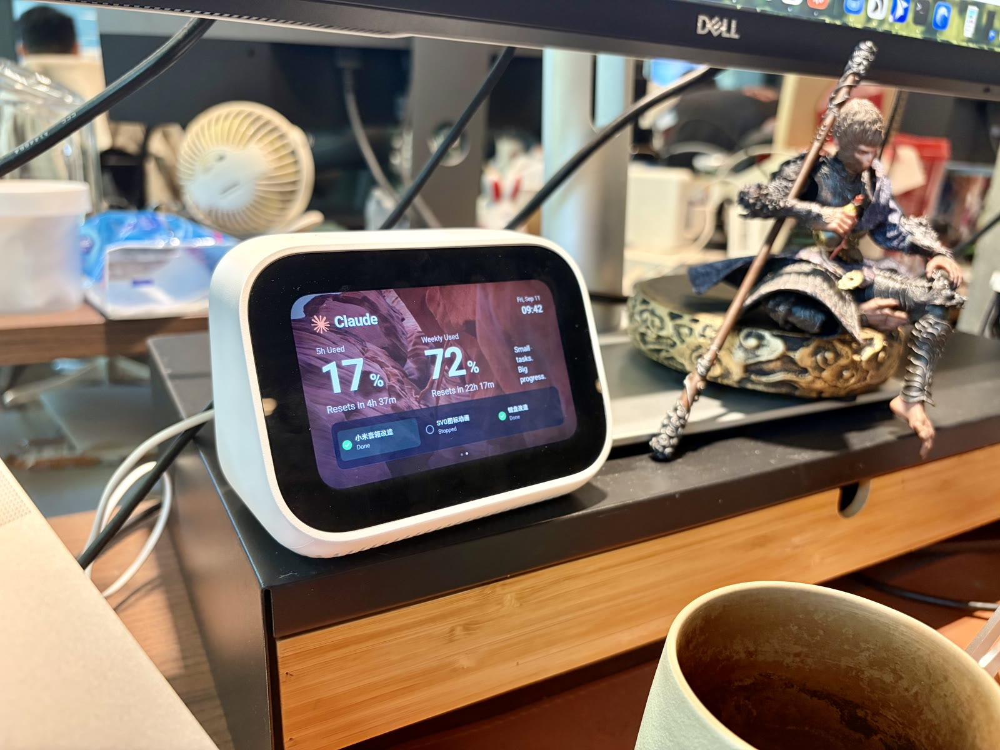
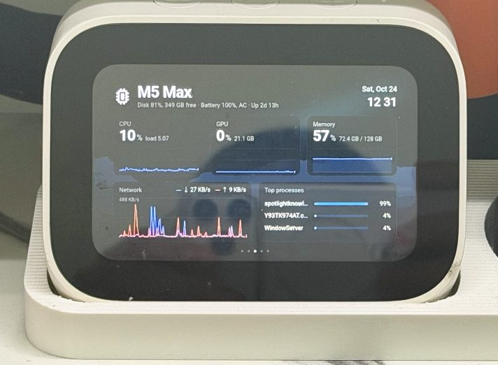
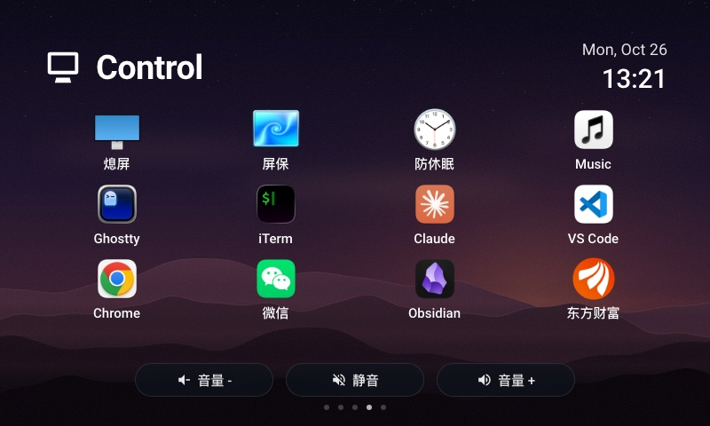
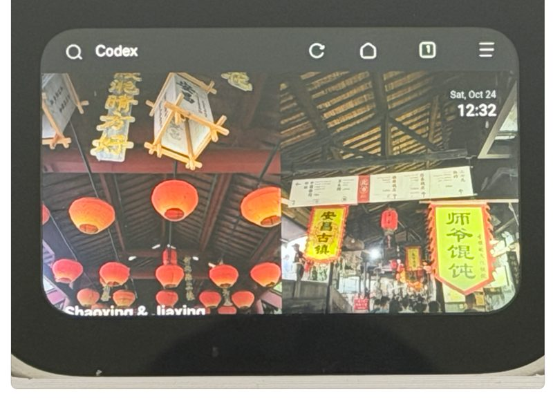
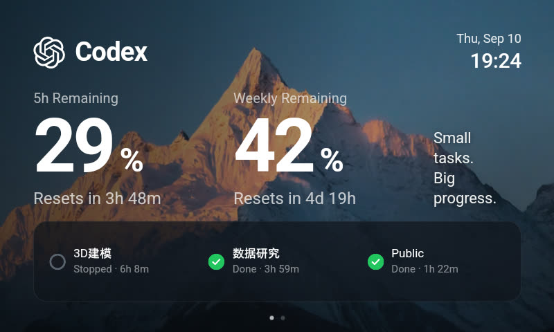
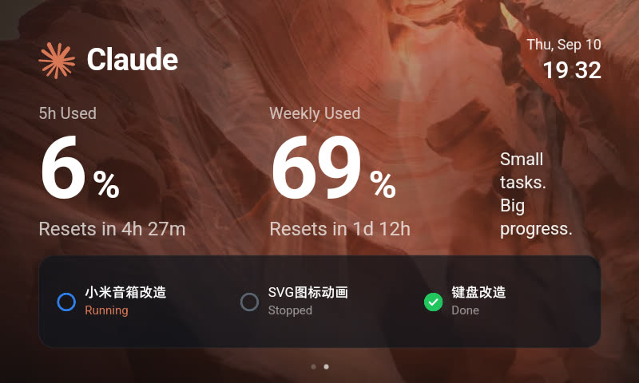
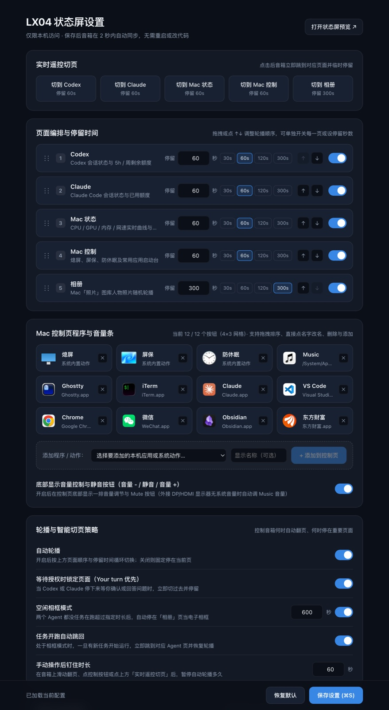
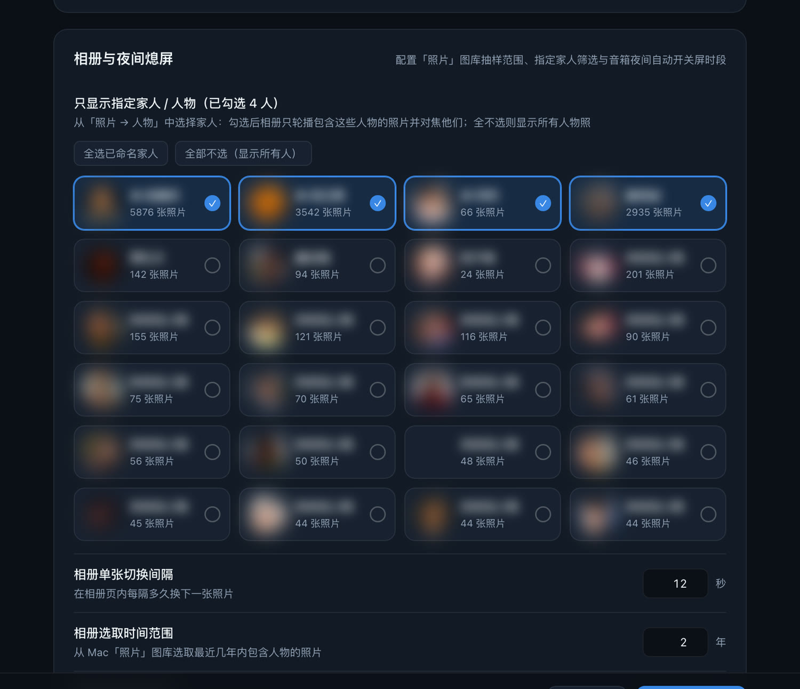

# LX04 Status Display

[中文](README.md) | English

Turn a flashed Xiaomi Xiao AI touchscreen speaker (LX04) into a desk status display for AI coding agents, a live Mac performance monitor, an app launcher, and a smart photo frame.



This repository builds on upstream [cenzihao1987-svg/lx04-status-display](https://github.com/cenzihao1987-svg/lx04-status-display) (Codex / Claude status pages). For initial device flashing, browser setup, or custom video encoding, refer to the upstream repository or [docs/刷机手册.md](docs/刷机手册.md) and [docs/使用说明.md](docs/使用说明.md).

---

## What This Fork Adds & Improves

| Mac Performance | Mac Controls (with Volume Bar) | Smart Photos |
| --- | --- | --- |
|  |  |  |

| Codex | Claude |
| --- | --- |
|  |  |

### 1. Mac-Only Web Settings Center (`/setting`)

Open **`http://127.0.0.1:8477/setting`** on your Mac to configure the speaker in real time — no code edits or service restarts needed. Changes sync to the speaker within **2 seconds**:



- **Live Remote Page Switcher**: click any page button on your Mac to immediately jump the speaker to that page
- **Page Order, Visibility & Dwell Time**: drag-and-drop or use `↑` `↓` to reorder the 5 pages, toggle individual pages on/off, and set per-page dwell durations
- **Customizable Mac Control Apps**: automatically scans `/Applications`, `/System/Applications`, and `~/Applications` so you can add, remove, rename, and drag-reorder up to 12 apps or built-in actions (icons are extracted and cached automatically from `.app` bundles)
- **Rotation & Smart Follow Policies**: toggle auto-rotation, lock on `NeedsApproval` ("Your turn"), idle photo-frame mode, auto-return when a task starts, and manual pin duration
- **Photos & Night Screen-Off Schedule**: pick specific family members from a visual face-avatar grid in `/setting` so the slideshow only shows photos of your family (and centers crops on them), plus configure slideshow intervals, year range, sample count, and night sleep/wake hours (synced automatically to `adb-endpoint.json`)
- **Strict Mac-Only Access**: `/setting` and `/api/settings` are guarded by `access.mac_only` — only loopback and the Mac's own NIC IP are allowed; the speaker and other LAN devices receive `403`

### 2. Mac Controls Page (App Launcher + Volume / Mute Bar)

- **4×3 Icon Grid**: put the Mac's display to sleep, launch the screen saver, toggle `caffeinate` keep-awake, or open any app configured in `/setting`
- **Bottom Volume & Mute Bar**: dedicated `Volume -`, `Mute`, and `Volume +` pill buttons at the bottom of the Control page (can be toggled in `/setting`). Controls macOS system output volume first, and automatically falls back to `Music.app` volume when an external DisplayPort/HDMI monitor does not expose system volume controls

### 3. Live Mac Performance Monitor

- **Real-Time Metrics & 4-Minute Charts**: CPU, GPU, memory (matching Activity Monitor: App + Wired + Compressed), physical NIC network throughput, and top CPU processes
- **Zero Permissions & Lazy Sampling**: reads CPU ticks via `ctypes` mach `host_statistics` and GPU utilization via `ioreg -c IOAccelerator` — no `sudo` required, and nothing is sampled when nobody is viewing

### 4. Smart People Photos & Idle Photo-Frame Mode



- **Family Member Filter (Exclude Strangers)**: reads recognized people and face thumbnails (`ZPERSON` + `ZFACECROP`) directly from your macOS Photos library and displays an avatar wall in `/setting`. Select specific family members (or click "Select all named people") so the slideshow **only shows photos containing your family**, filtering out coworkers, event crowds, and strangers
- **Server-Side Face-Aware Cropping Focused on Family**: crops landscape photos to `800×480` and portrait photos to `400×480` (paired side-by-side) centered specifically on your selected family members' faces via `sips` (ignoring passersby in the same frame), caching results so the speaker's weak GPU stays smooth
- **Automatic Quality Filtering**: opens `Photos.sqlite` read-only (`mode=ro`) and uses face size (`ZSIZE ≥ 5%`) and aesthetic scores (`ZOVERALLAESTHETICSCORE ≥ 0.3`) to skip pets, tiny background faces, and scanned ID documents
- **Idle Photo-Frame Mode**: parks on the Photos page when both Codex and Claude have been idle for the configured threshold (default 10 minutes), and jumps back as soon as a new task starts

### 5. Additional Improvements

- **Night Screen-Off & Morning Wake**: sends `KEYCODE_SLEEP` at night (default `23:00–07:00`) and wakes the screen back to the status page in the morning; sleeps at most once per boot so manual wake-ups at night are respected
- **LAN Access Control & Hardware Serial Pinning**: only the Mac itself, the speaker pinned by hardware `ro.serialno`, and IPs in `LX04_CONTROL_ALLOW` can connect; all write endpoints require `X-LX04-Action: 1` and validate the `Host` header against DNS rebinding
- **Fixed Claude Quota Reading**: reads live usage from the `claude-hud` statusline plugin cache (`.usage-cache.json`) first, falling back to Claude Desktop's local cache
- **One-Command Setup**: `./scripts/setup.sh` checks dependencies, clones and patches `mibe`, runs unit tests, pairs with the speaker over wireless ADB, and installs login LaunchAgents

---

## Quick Start

> For first-time speaker flashing, installing the Via browser, and enabling wireless ADB, see the upstream repository and [docs/刷机手册.md](docs/刷机手册.md).

```bash
git clone https://github.com/syu-lk4b/xiaoai-lx04-agent-screen.git
cd xiaoai-lx04-agent-screen
./scripts/setup.sh --device 192.168.x.x   # speaker LAN IP (omit to auto-scan subnet)
```

Once installed:

- **Status Display**: `http://127.0.0.1:8477/` (opened on the speaker via `adb-bridge` forwarding)
- **Mac Settings Page**: `http://127.0.0.1:8477/setting` (accessible on the Mac only)

Common commands:

| Task | Command |
| --- | --- |
| Run in foreground | `./scripts/start.sh` |
| Reinstall login LaunchAgents | `./scripts/install-agent.sh` |
| Restart status service | `launchctl kickstart -k gui/$(id -u)/com.gerry.lx04-status` |
| Restart ADB bridge | `launchctl kickstart -k gui/$(id -u)/com.gerry.lx04-adb-bridge` |
| Tail logs | `tail -f ~/Library/Logs/lx04-status.log ~/Library/Logs/lx04-adb-bridge.log` |

---

## Architecture Overview

```
~/.codex/sessions/*.jsonl ──→ mibe event tailing ──┐
~/.claude/projects/*.jsonl ─→ claude.py polling ───┤→ AGENTS dict → snapshot()
 system.py (CPU/mem/GPU/network) ──────────────────┤        ↓
 photos.py (photos, re-drawn every 10 min) ────────┤   HTTP :8477
 settings.py (page order/controls/sleep config) ───┘  access.py caller check (/setting is Mac-only)
                                                          ↓
                  adb reverse (USB) or toybox nc proxy (wireless ADB, over Wi-Fi)
                                                          ↓
        Via browser opens http://127.0.0.1:8477/ (polls every 2s and syncs state + settings)
```

---

## License

MIT, see [LICENSE](LICENSE). Background videos and images belong to their respective authors.
